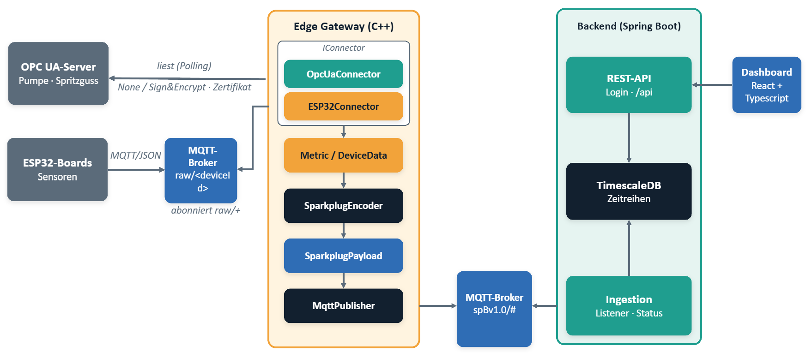
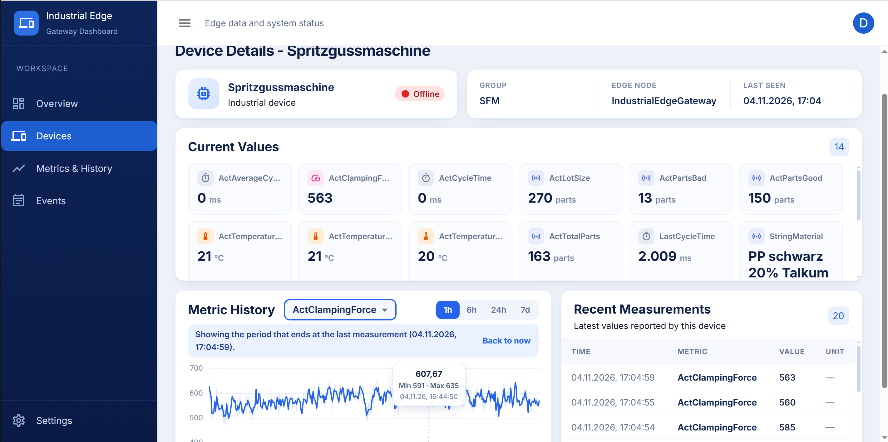

# Industrial Edge Gateway

An industrial edge gateway that connects heterogeneous data sources, standardizes their data and publishes it using **Sparkplug B over MQTT**. A backend stores measurements in **TimescaleDB** and provides them through a REST API to a web dashboard.

## Architecture



The gateway uses protocol-specific connectors to collect data and convert it into a common `Metric` / `DeviceData` model. The Sparkplug B encoder transforms this data into standardized messages, which are published to the MQTT broker.

The architecture separates data acquisition, message encoding, communication and persistence. Adding a new machine using a supported protocol primarily requires configuration rather than changes to the gateway core.

## Features

- **Multi-source data acquisition:** ESP32 sensor boards via MQTT/JSON and industrial equipment via OPC UA.
- **Common data model:** Standardized `Metric` and `DeviceData` structures independent of the original data source.
- **Sparkplug B:** Device lifecycle management through Birth, Data, Rebirth and Death messages, including Report by Exception.
- **Industrial connectivity:** Configurable OPC UA endpoints, security settings, credentials and supported data types.
- **Data persistence:** Time-series measurements stored in TimescaleDB.
- **Backend API:** REST endpoints for device management, measurements, historical data and system events.
- **Authentication:** Session-based authentication and CSRF protection.
- **Web dashboard:** Device status monitoring, current metric values, historical charts and event filtering.
- **Containerized deployment:** Docker Compose integration of the gateway, backend, database and dashboard.

## Dashboard Preview

The web dashboard provides an overview of connected devices, their operational status, current measurements, historical trends and recent system events.



## Technology Stack

| Component | Technologies |
|---|---|
| Gateway | C++17, CMake, Paho MQTT C++, open62541, open62541pp, Protobuf |
| Sensor firmware | C++, ESP32, PlatformIO |
| Backend | Java 21, Spring Boot, JPA, Flyway |
| Database | TimescaleDB, PostgreSQL |
| Dashboard | React, TypeScript, Material UI, Vite |
| Infrastructure | Docker, Docker Compose, Eclipse Mosquitto |

## Getting Started

### Prerequisites

- Docker and Docker Compose
- Git
- An accessible MQTT broker (Eclipse Mosquitto)
- Accessible OPC UA servers
- Java 21 and Node.js (LTS), if running components locally
- CMake, a C++17 compiler and [vcpkg](https://github.com/microsoft/vcpkg), if building the Gateway locally

### 1. Clone the Repository

```bash
git clone https://github.com/gienyne/Industrial_edge_gateway.git
cd Industrial_edge_gateway
```

### 2. Configure the Environment

Create the root environment file:

```bash
cp .env.example .env
```

Configure the required environment variables, including database credentials and dashboard administrator credentials.

Create the Docker-specific gateway configuration:

```bash
cp gateway/config_docker/config.docker.json.example gateway/config_docker/config.docker.json
```

Adapt the configuration to your MQTT broker, OPC UA sources, credentials and certificates.

For local backend development, also create its environment file:

```bash
cp backend/.env.example backend/.env
```

### 3. Start the Application with Docker Compose

Build and start the services:

```bash
docker compose up --build -d
```

Check the status of the containers:

```bash
docker compose ps
```

To start only TimescaleDB, for example when developing the backend locally:

```bash
docker compose up -d timescaledb
```

### 4. Access the Application

Once the services are running, the following interfaces are available:

| Service | Address |
|---|---|
| Dashboard | http://localhost:8083 |
| Backend API | http://localhost:8082 |
| Adminer | http://localhost:8081 |
| TimescaleDB | `localhost:5432` |
| MQTT broker | `localhost:1883` |

Sign in to the dashboard using the administrator credentials configured in the environment file.

## Running Components Locally (Optional)

The backend, dashboard and gateway can also be started independently for development.

**Backend**

First, ensure that TimescaleDB is running:

```bash
docker compose up -d timescaledb
```

Start the Spring Boot application:

```bash
cd backend
.\gradlew.bat bootRun
```

The backend uses port `8082`, as configured in `application.yml`. When running locally, it connects to TimescaleDB through `localhost:5432`. Flyway automatically handles database schema migrations at startup.

**Dashboard**

From the `dashboard` directory:

```bash
npm install
npm run dev
```

Open the URL provided by Vite, usually `http://localhost:5173`.

**Gateway**

The gateway uses [open62541](https://open62541.org/) and its C++ wrapper [open62541pp](https://github.com/open62541pp/open62541pp) for OPC UA communication.

C++ dependencies are managed through [vcpkg](https://github.com/microsoft/vcpkg) and declared in `gateway/vcpkg.json`. They include Paho MQTT C++, nlohmann-json, Protocol Buffers and the OPC UA libraries.

**Using Docker (recommended)**

The Docker build automatically installs vcpkg and all dependencies declared in `gateway/vcpkg.json`. No local C++ toolchain, CMake or vcpkg installation is required.

Create the Docker-specific configuration:

```bash
cp gateway/config_docker/config.docker.json.example gateway/config_docker/config.docker.json
```

Configure the MQTT broker, OPC UA endpoints, credentials and certificates.

Build and start the application from the project root:

```bash
docker compose up --build -d
```

**Local development on Windows (optional)**

Install a C++ compiler, CMake and vcpkg. Then create the local configuration:

```bash
cp gateway/config/config.json.example gateway/config/config.json
```

Build the Gateway from its directory. Adjust the vcpkg toolchain path to match your installation:

```bash
cd gateway
cmake -B build -S . -DCMAKE_TOOLCHAIN_FILE=C:/vcpkg/scripts/buildsystems/vcpkg.cmake
cmake --build build --config Debug
```

Run the executable from the `gateway` directory so that relative configuration paths resolve correctly:

```powershell
.\build\Debug\gateway.exe
```

## Documentation

Further technical details, architecture decisions and component descriptions are available in the [`docs/`](docs/) directory.

- [System overview](docs/architektur/overview.md)
- [Data models](docs/architektur/data_models.md)
- [Gateway connectors](docs/architektur/Gateway_Connectors.md)
- [Gateway application](docs/architektur/gateway_application.md)
- [Sparkplug encoder](docs/architektur/sparkplug_encoder.md)
- [MQTT publisher](docs/architektur/mqtt_publisher.md)
- [Configuration](docs/architektur/configuration.md)
- [Backend documentation](backend/README.md)
- [Dashboard documentation](dashboard/README.md)
- [Sprint documentation](docs/sprints/)
